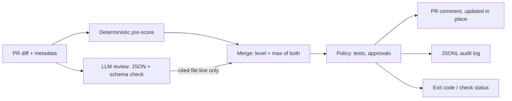

# 01 PR risk gate

Scores pull-request risk from the diff, asks a model to review it with cited evidence, and
enforces review rules. Ships as a GitHub Action, a CLI and a Claude Code skill.

## For engineering leaders

**The problem.** AI-assisted changes arrive faster and look plausible, so risky ones (auth, IAM,
migrations, CI) can merge with the same light review as a docs fix. Developers report that
AI output is often "almost right, but not quite" (66% in the Stack Overflow 2025 survey; see
[docs/sources.md](../../docs/sources.md), flagged VERIFY).

**What this proves.**

- Every PR gets a risk level, and the level is decided by code, not by a model's opinion.
- A high-risk PR with no test changes cannot merge. The failure message names the files and lines.
- A high-risk PR needs a second human approval. The gate never approves or merges anything.
- Every decision is written to a tamper-evident audit log you can hand to an auditor.
- If the model is down or returns junk, the gate still works and says so.

**The metric.** _Percent of high-risk PRs that shipped with tests_, plus change failure rate and
PR cycle time (from piece 03). The `metrics` command computes the first from the audit log.
"Good" is 100% for high-risk PRs, with cycle time for high-risk PRs not rising by more than the
extra review time you chose to accept. Targets for change failure rate are yours to set; see
piece 03.

**Adopt it in a week.**

1. Day 1: copy `risk-gate.example.yml` to `risk-gate.yml` in your repo, edit the path lists to match your repo, run in `observe` mode
   (reports, never blocks).
2. Days 2 to 4: read the comments, tune paths and thresholds until the levels match your instinct.
3. Day 5: switch to `enforce`, and mark the check as required in branch protection.
4. Ongoing: run `metrics` monthly and review the audit log artifact.

**Limits.**

- It scores a diff, not behavior. It does not run your code or your tests.
- "Has test changes" means test files changed, not that the tests are good.
- The second-approval rule counts review approvals or a label. It does not parse CODEOWNERS; use
  branch protection's "Require review from Code Owners" for ownership.
- Very large PRs (the GitHub diff API refuses roughly 3,000+ changed lines or 300+ files) make
  the gate fail closed instead of guessing.
- Model reasons are advisory. A reason that cites a line not in the diff is dropped.

## For engineers

### Architecture



- `diff.ts` parses a unified diff into files and added-line numbers.
- `prescore.ts` classifies files (docs, tests, risk categories) and scores size and test ratio.
- `review.ts` builds the prompt, validates model JSON with zod, and drops uncited reasons.
- `policy.ts` applies the rules. The model can raise a level, never lower the pre-score.
- `github.ts` is a small fetch client that can read PRs and post one comment. It has no method for
  approving, merging, or editing code.
- `run.ts` wires it together; `cli.ts` is the entry point; `metrics.ts` reads the audit log.

### Install and run

```bash
pnpm install
# Local, offline, from a diff file and metadata (what the demo does):
pnpm --filter @adl/pr-risk-gate risk-gate evaluate \
  --diff pieces/01-pr-risk-gate/demo/fixtures/pr3-auth-no-tests.diff \
  --meta pieces/01-pr-risk-gate/demo/fixtures/pr3-auth-no-tests.meta.json \
  --llm replay --fixtures pieces/01-pr-risk-gate/demo/llm-fixtures
# Metric from an audit log:
pnpm --filter @adl/pr-risk-gate risk-gate metrics --log path/to/audit.jsonl
```

In GitHub Actions, reference the action from this repo (pin by SHA):

```yaml
permissions:
  contents: read
  pull-requests: write
jobs:
  gate:
    runs-on: ubuntu-latest
    steps:
      - uses: actions/checkout@<sha>
      - uses: <owner>/rollcage/pieces/01-pr-risk-gate@<sha>
        env:
          ANTHROPIC_API_KEY: ${{ secrets.ANTHROPIC_API_KEY }} # optional
```

Without `ANTHROPIC_API_KEY` the gate runs on the deterministic pre-score alone and says so.

### Config reference (`risk-gate.yml`)

| Key                                           | Default                                       | Meaning                                                                                                         |
| --------------------------------------------- | --------------------------------------------- | --------------------------------------------------------------------------------------------------------------- |
| `mode`                                        | `enforce`                                     | `observe` reports violations but exits 0.                                                                       |
| `risk_paths.<name>.level`                     | per category                                  | `medium` or `high`.                                                                                             |
| `risk_paths.<name>.paths`                     | built-in lists                                | Globs (`**`, `*`, `?`). A pattern with no `/` matches the file name anywhere.                                   |
| `test_paths`, `doc_paths`                     | common patterns                               | Files counted as tests or docs. Test and doc files never trigger risk categories.                               |
| `thresholds.medium_diff_lines`                | `100`                                         | Changed non-test lines that add size risk.                                                                      |
| `thresholds.large_diff_lines`                 | `400`                                         | Changed lines that add more size risk.                                                                          |
| `thresholds.min_test_ratio`                   | `0.25`                                        | Test lines per source line below which a sizable change gains risk.                                             |
| `second_approval.mode`                        | `reviews`                                     | `reviews` counts distinct human approvers; `label` accepts a maintainer-applied label.                          |
| `second_approval.required` / `.label`         | `2` / `second-approval`                       | Approvals needed (the author never counts) / the label name.                                                    |
| `max_diff_chars`                              | `60000`                                       | Diff size sent to the model; the rest is cut and the comment says so.                                           |

Defaults live in `src/config.ts`. Model id: `ANTHROPIC_MODEL` (default in `shared/ts/src/config.ts`).

### Scoring rules

- Docs-only change: `low`.
- Any non-test, non-doc file in a `high` category (auth, IAM/IaC, migrations, CI workflows,
  secrets-adjacent config): `high`. Dependency lockfiles are `medium`.
- Size: at least `medium_diff_lines` adds 15 points; at least `large_diff_lines` adds 30.
- Low test ratio on a sizable change adds 20 points.
- A risk category adds 60 points (`high`) or 30 (`medium`); the largest matching category counts.
- Points are capped at 100. 60 or more is `high`, 25 or more is `medium`, otherwise `low`.

### Policy rules

| Id                  | Applies when                                      | Result                                  |
| ------------------- | ------------------------------------------------- | --------------------------------------- |
| `tests-required`    | final level is `high` and no test file changed    | check fails                             |
| `approvals-required`| final level is `high` and approvals are short     | check fails                             |

In `observe` mode the same violations are listed as "would block" and the exit code is 0.

### Acceptance criteria (each has a test)

- AC-1: the diff parser reports files, added-line numbers, adds and removes, renames and deletes.
- AC-2: a docs-only PR scores `low`; an auth change scores `high`; categories are configurable.
- AC-3: a test file inside a risk path does not raise risk.
- AC-4: model JSON that fails the schema is retried once, then the deterministic result is used,
  and the comment states the model was not used.
- AC-5: reasons citing a file or line not in the diff are dropped and counted.
- AC-6: the model can raise the level but never lower the pre-score.
- AC-7: high risk without test changes fails; high risk with too few approvals fails; the author
  and bots do not count as approvers.
- AC-8: observe mode never fails the check but lists what would block.
- AC-9: one comment is created, then updated in place on later runs.
- AC-10: the GitHub client only issues reads plus comment create and update.
- AC-11: each decision appends one audit record with the PR number, levels and violations.
- AC-12: model text is neutralized (no live `@mentions`, no raw HTML) before it is posted.
- AC-13: `metrics` reports the percent of high-risk PRs that had tests, using each PR's latest decision.

### How to extend

Add a category by adding a `risk_paths` entry. Add a policy rule in `policy.ts` and a test. To
support another forge, implement `GateIO` from `run.ts`.

### Tests

```bash
pnpm --filter @adl/pr-risk-gate coverage
```

Tests use `FakeLlm`, a fake GitHub `fetch`, and fixture diffs. No test uses the network.

### Runtime dependencies

| Package        | Why                                                         |
| -------------- | ----------------------------------------------------------- |
| `zod`          | Validate model output and config.                           |
| `yaml`         | Parse `risk-gate.yml`.                                      |
| `@adl/shared`  | LLM interface, fake and replay, audit log (workspace).      |

### Security notes

- The diff is untrusted input and may contain text that tries to instruct the model. The prompt
  says so, the output must match a schema, and the model cannot lower the level or change the
  verdict. Policy decisions never read model prose.
- The token needs only `contents: read` and `pull-requests: write`. Use the `pull_request`
  trigger, not `pull_request_target`, so fork code never runs with a write token.
- The gate fails closed when it cannot read the diff.
- Claude Code skill format checked against https://code.claude.com/docs/en/skills (2026-11-24):
  `.claude/skills/<name>/SKILL.md`, symlinked directories are supported.

### Claude Code skill

`skill/SKILL.md` (linked from `.claude/skills/pr-risk-gate`) runs the same scoring on the current
branch before a PR exists. It is deterministic by default and never posts or approves anything.

### This repository uses it

`.github/workflows/pr-risk-gate.yml` runs the gate on this repo's own PRs, in `observe` mode
(`risk-gate.yml` at the root) because there is one maintainer and a two-approval rule would block
every PR. `.github/workflows/piece-01-pr-risk-gate.yml` runs the piece's tests and the demo.

### Status

Draft for review. Not yet run on GitHub: the action, the two workflows and the live GitHub API
paths are covered by unit tests with a fake `fetch`, not by a real run. Demo model responses are
hand-authored and replayed (`pnpm --filter @adl/pr-risk-gate demo:record` rewrites them; with
`DEMO_LIVE=1` it records real ones). Re-record against a live model before publishing the video.
The first real run will also show whether the composite action installs cleanly when used from
another repository.
