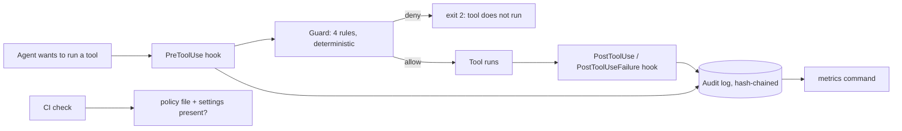

# 02 Agent policy and guardrails

A one-page AI coding agent policy, plus the hooks, settings and CI check that enforce it for
Claude Code and produce evidence an auditor can read.

## For engineering leaders

**The problem.** Engineers already use coding agents. Without written rules and enforcement, you
cannot say what those agents may read, run or send, and you cannot show anyone what they did.
Developers also report limited trust in AI output (46% distrust its accuracy in the Stack Overflow
2025 survey; see [docs/sources.md](../../docs/sources.md), flagged VERIFY).

**What this proves.**

- The policy fits on one page and has a clause for every control below.
- An agent that tries to read a `.env` file, force-push, write outside the repo or call an
  unlisted host is stopped before the action runs, not told off afterward.
- Every tool call lands in a tamper-evident audit log, including the blocked ones.
- A CI check fails any repository that drops the policy file or the guardrail settings.
- You can report two numbers from the log: blocked risky actions per week, and the percent of
  agent sessions with a complete audit trail.

**The metric.** Blocked risky actions per week (a non-zero number means the guardrails are
working and someone should look at what was attempted), and the percent of sessions with a
complete audit trail. "Good" is 100% complete trails and a weekly review of every blocked action.

**Adopt it in a week.**

1. Day 1: copy `policy/AI_CODING_AGENT_POLICY.md`, fill in the placeholders, get it approved.
2. Day 2: build the hook (`pnpm --filter @adl/agent-policy build`), copy it and
   `templates/settings.json` into `.claude/`, and set your allowed hosts in `.claude/agent-policy.yml`.
3. Day 3: add the CI check so a repo without the policy or settings fails.
4. Days 4 to 5: run for a few sessions, read the blocked list, tune the allowlists.
5. Ongoing: review `agent-policy metrics` weekly.

**Limits.**

- The checks on shell commands are heuristic string analysis. A determined or confused agent can
  find a command shape that gets through. Treat the hook as a guardrail, and add an OS sandbox for
  a hard boundary. Claude Code's own docs say the same about its Bash permission rules.
- Hooks run with the developer's own permissions, and a developer or a higher-precedence settings
  file can switch hooks off (`disableAllHooks`). To make enforcement unremovable, deploy the same
  settings through managed (organization) settings.
- It covers Claude Code. Copilot and Cursor are covered by the policy text only; use their admin
  controls and compare them in piece 14.
- A wildcard with no literal start, such as `cat *.json`, is checked only against wildcard secret
  patterns (`*.pem`), so it can still read a file named `secrets.json`. Tighter matching blocked
  ordinary commands like `grep x .github/workflows/*.yml` during this repo's own use.
- MCP tools are not inspected. Govern them with permission rules.
- Environment dumps (`env`, `printenv`) are not blocked, and a `Grep` over a whole directory can
  surface a secret file's contents if you do not also set the deny rules in the template.
- **A call blocked by a `permissions.deny` rule is not in the audit log.** Checked live on
  2026-11-24: a `Read` of `.env` was refused by the `Read(./.env)` deny rule, and the hook never
  ran, so no record exists. The docs say the `PermissionDenied` event does not fire for deny
  rules either. The template keeps the deny rules as a second layer, so the "blocked actions per
  week" number counts only blocks made by the hook and undercounts the rest. If you need every
  block on record, drop the `Read(...)` deny rules and let the hook make that decision.
- The audit log proves what the hooks saw. It cannot show actions taken outside the agent.

## For engineers

### Architecture



The hook protocol, settings schema and permission rule syntax were checked against the current
Claude Code docs on 2026-11-24 ([hooks](https://code.claude.com/docs/en/hooks),
[settings](https://code.claude.com/docs/en/settings),
[permissions](https://code.claude.com/docs/en/permissions)). Facts used:

- Hooks live in `.claude/settings.json` as `hooks.<Event>[].{matcher, hooks[].{type, command, timeout}}`.
- A hook receives JSON on stdin with `tool_name`, `tool_input`, `cwd`, `session_id`, `tool_use_id`.
- Exit code 2 blocks the call and sends stderr to the model. Exit code 1 is not a block, so the hook
  exits 2 on every error it can catch. A hook that cannot start at all (missing file, missing
  runtime) exits with another code, which would let the call run, so the PreToolUse entry also sets
  `"onFailure": "block"` (a handler field in the hooks docs, from Claude Code 2.1.295; check your
  version). `check` fails without it. The cost: if the hook is broken, every tool call is blocked
  until you fix or remove the hook entry in `.claude/settings.json`. Edits made through the
  agent are blocked too, so recover from outside the session: edit the file in an editor or a plain
  terminal, or start Claude Code with `--settings '{"disableAllHooks": true}'`, which the hooks
  docs say overrides project and local settings files (untested here).
- Exit 2 blocks even in `bypassPermissions` mode. A `PostToolUse` hook does not fire for a blocked
  call, so the blocking hook writes its own audit record.

### Rules enforced by the hook (`src/guard.ts`)

| Rule id              | Blocks                                                                                                                        |
| -------------------- | ----------------------------------------------------------------------------------------------------------------------------- |
| `secret-read`        | Read, Edit, Write, Grep on secret paths (`.env*`, keys, `.aws/`, `.ssh/`, ...); shell commands that name one                  |
| `force-push`         | `git push` with `--force`, `-f`, `--force-with-lease`, or a `+refspec`, also inside `sh -c`                                   |
| `write-outside-repo` | Write/Edit outside the repo and allowed scratch dirs; shell redirects and file-changing commands aimed outside                |
| `network-allowlist`  | WebFetch and shell network tools (curl, wget, ssh, git URLs, ...) to hosts not on the allowlist, or with no determinable host |
| `unparseable`        | A shell command the analyzer cannot parse (unbalanced quotes). Fail closed.                                                   |

Everything else is allowed by the hook. Permission rules in `templates/settings.json` add a second layer.

### Policy to enforcement to evidence

| Policy clause                 | Enforcement                                                             | Evidence                                            |
| ----------------------------- | ----------------------------------------------------------------------- | --------------------------------------------------- |
| 4. Never read or send secrets | `secret-read` rule; `permissions.deny` Read rules                       | `deny` record with rule `secret-read`               |
| 4. No force-push              | `force-push` rule; `permissions.deny` and `ask` Bash rules              | `deny` record with rule `force-push`                |
| 4. No writes outside the repo | `write-outside-repo` rule                                               | `deny` record with rule `write-outside-repo`        |
| 4. No unlisted hosts          | `network-allowlist` rule; `WebFetch(domain:...)` allow rules            | `deny` record with rule `network-allowlist`         |
| 3. Pushing needs approval     | `permissions.ask` for `Bash(git push *)`                                | Claude Code permission prompt; `allow` record       |
| 4. Do not disable guardrails  | `check` fails if hooks are missing or `disableAllHooks` is true         | CI result                                           |
| 6. Every tool call is logged  | Pre and post hooks, fail closed if the log cannot be written            | Hash-chained `agent.audit.jsonl`; `metrics` command |
| 1 to 9. A policy exists       | `check` fails if `policy/AI_CODING_AGENT_POLICY.md` is missing or empty | CI result                                           |

### Install

```bash
pnpm install
pnpm --filter @adl/agent-policy build           # writes dist/agent-policy-hook.mjs
mkdir -p .claude/hooks
cp pieces/02-agent-policy/dist/agent-policy-hook.mjs .claude/hooks/
cp pieces/02-agent-policy/templates/settings.json .claude/settings.json
cp pieces/02-agent-policy/templates/agent-policy.yml .claude/agent-policy.yml
```

This repository runs the same hooks from source (`tsx`) in its own `.claude/settings.json`, so it
never runs a stale build. Each tool call starts two hook processes. On one machine the bundle took
about 65 ms per process and `tsx` about 190 ms, so adopters should use the bundle.

### Config (`.claude/agent-policy.yml`)

| Key                 | Default                                        | Meaning                                                          |
| ------------------- | ---------------------------------------------- | ---------------------------------------------------------------- |
| `allowed_hosts`     | docs and package hosts, loopback               | Hosts the agent may contact. `*.example.com` matches subdomains. |
| `allow_write_dirs`  | `/tmp`, `/private/tmp`, `~/.claude`            | Extra directories outside the repo that may be written.          |
| `secret_paths`      | built-in list                                  | Globs treated as secrets. Replaces the default list when set.    |
| `secret_exceptions` | `.env.example`, `.env.sample`, `.env.template` | Secret-looking paths that are fine to read.                      |
| `allow_web_search`  | `true`                                         | WebSearch is not host-scoped, so it is a switch.                 |
| `audit_required`    | `true`                                         | If the audit log cannot be written, block the call.              |

### Commands

```bash
pnpm --filter @adl/agent-policy agent-policy hook pre    # reads hook JSON on stdin
pnpm --filter @adl/agent-policy agent-policy hook post
pnpm --filter @adl/agent-policy agent-policy check --root .
pnpm --filter @adl/agent-policy agent-policy metrics --log .claude/audit/agent.audit.jsonl
```

`pnpm policy:check` runs the CI check on this repository.

### Acceptance criteria (each has a test)

- AC-1: Read, Grep, Edit and Write on `.env`, key files and credential directories are denied;
  `.env.example` is allowed.
- AC-2: shell commands that reference a secret path (cat, source, redirects, `sh -c`) are denied.
- AC-3: `git push` with any force form is denied, including through `sh -c`, `git -C`, wrappers and `+refspec`.
- AC-4: writes outside the repo are denied for file tools and for shell redirects and write commands;
  `/dev/null` and allowed scratch dirs are fine.
- AC-5: WebFetch and shell network tools to unlisted hosts are denied; listed hosts and loopback are allowed;
  an unresolvable destination is denied.
- AC-6: normal development commands (tests, builds, git status, reading source) are allowed.
- AC-7: invalid hook input, bad config and an unwritable audit log all end in exit 2.
- AC-8: every pre decision and every post outcome appends one audit record without storing command text
  or file contents; concurrent hooks keep the chain valid.
- AC-9: `check` fails when the policy file, the hooks, the deny rules or the guardrail settings are missing.
- AC-10: `metrics` reports blocked actions per week and the percent of sessions with a complete trail.

### Runtime dependencies

| Package         | Why                                              |
| --------------- | ------------------------------------------------ |
| `zod`           | Validate hook input and config.                  |
| `yaml`          | Parse `agent-policy.yml`.                        |
| `@adl/shared`   | Audit logger and glob matcher (workspace).       |
| `tsx`           | Run TypeScript hooks from source in this repo.   |
| `esbuild` (dev) | Bundle the hook into one file adopters can copy. |

### Security notes

- The hook never echoes command text or file contents into the audit log, only hashes and the
  tool name, rule and target path or host.
- A deny reason names the rule and the path or host, not the content that triggered it.
- The audit log is append-only and hash-chained, but a user who can edit the file can rewrite the
  chain. Ship it somewhere the developer cannot modify if you need stronger evidence.
- Concurrent tool calls are serialized by the shared `AuditLogger`, which appends under a lock file and reads only the end of the log, so the chain stays valid and the cost does not grow with the log.

### Status

Draft for review. The unit tests use payload shapes taken from the docs. In addition, this
repository's own `.claude/settings.json` ran the hooks during this build, and the live records have
the documented fields (`session_id`, `tool_use_id`, `tool_name`). The hook's exit-2 block path was
then seen live once: during piece 03 a shell command with a variable as its redirect target was
refused with rule `write-outside-repo`. A `Read` of `.env` was refused by the deny rule instead
(see Limits). The demo replays payloads; it does not drive a real agent.
