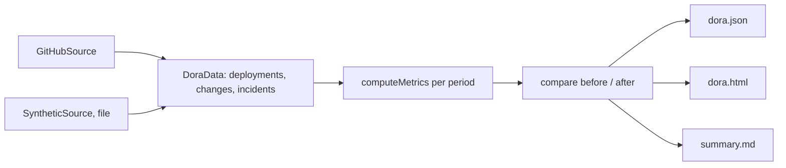

# 03 DORA metrics

A CLI and a scheduled GitHub Action that compute DORA's five software delivery metrics from the
GitHub API, split around the date you rolled out AI tools. It writes JSON, a single-file HTML
dashboard, and a short markdown summary written for a CFO.

## For engineering leaders

**The problem.** You bought AI coding tools and someone will ask whether they paid off. Commit
counts and "developers feel faster" do not answer that. Delivery metrics do, and they also show
the other side: DORA's guide groups the five metrics into throughput and instability, and says
top performers do well across all five (see [docs/sources.md](../../docs/sources.md); flagged
VERIFY).

**What this proves.**

- Five numbers, computed the same way before and after your rollout date, from data you already
  have in GitHub.
- Throughput and instability side by side, so a speed-up that comes with more failures is visible.
- Every definition is written down, including where it approximates DORA, so nobody has to trust a
  black box.
- Small samples are flagged instead of presented as findings.

**The metrics.** DORA's own names, with the definitions this tool uses:

| Metric                              | How this tool measures it                                                                              | Better is |
| ----------------------------------- | ------------------------------------------------------------------------------------------------------ | --------- |
| Deployment frequency                | Successful production deployments per week.                                                            | higher    |
| Change lead time                    | Hours from a change's first commit to the first successful deployment at or after its merge. Median and p90. | lower     |
| Change fail rate                    | Share of successful deployments followed, within the failure window, by a revert, hotfix or incident.  | lower     |
| Failed deployment recovery time     | Hours to recover: incident opened to closed, or failed deployment to the next good one. Median and p90. | lower     |
| Deployment rework rate              | Share of successful deployments that are unplanned fixes: the first deployment after a revert or hotfix merges. | lower     |

**What "good" looks like.** DORA's guide gives no numeric bands, and this tool does not invent
any. "Good" is your own trend: throughput up without instability rising, judged on at least
`min_samples` data points. Use the before and after split as your baseline.

**Adopt it in a week.**

1. Day 1: pick the deployment source (Deployments API, releases, or workflow runs on your default
   branch) and copy `dora.example.yml` to `dora.yml`.
2. Day 2: label incident issues (`incident`), hotfix PRs (`hotfix`), and use `Revert` in revert PR
   titles. The change fail and rework numbers are only as good as these labels.
3. Day 3: run `dora report --compare-at <your rollout date>` on 90 days of history.
4. Day 4: schedule the Action weekly and publish the HTML and summary as artifacts.
5. Day 5: review the caveats with your team before showing the numbers to anyone else.

**Limits.**

- A before and after split shows correlation. Many things change when a tool rolls out, so this
  does not prove the tools caused the difference.
- Lead time assumes deployments ship everything merged before them, in order. Cherry-picks,
  multiple environments per commit, and long-lived release branches break that assumption.
- DORA's guide does not give start and end events for most metrics, so these are this tool's
  documented choices. Compare your numbers with this tool's own history, not with another tool's.
- Change fail rate and rework rate depend on labels and title conventions. Unlabeled incidents
  are invisible.
- The Deployments API keeps statuses for 90 days, so older deployments from that source have no
  status. Releases and workflow runs do not have this limit.
- `GITHUB_TOKEN` in Actions is limited to 1,000 API requests per hour per repository. Large
  histories need a token with a higher limit; the tool stops with a clear message at a request
  budget instead of failing halfway.
- One repository, one environment. No per-team or per-service split yet.

## For engineers

### Architecture



- `Source` is the only GitHub-specific seam. `GitHubSource` implements it. A GitLab adapter would
  implement the same `load(range)` and return `DoraData`.
- `metrics.ts` is pure: data in, numbers out. `compare.ts` adds the before and after deltas.
- `render-*.ts` produce the three outputs. No server and no external assets.

### Install and run

```bash
pnpm install
# Offline demo with a synthetic, seeded history:
pnpm demo:03
# Your repository (needs GITHUB_TOKEN with read access):
pnpm --filter @adl/dora-metrics dora report --repo owner/name --config dora.yml \
  --since 2026-01-01 --until 2026-06-30 --compare-at 2026-03-15 --out dora-out
```

### Config (`dora.yml`)

| Key                                    | Default          | Meaning                                                                    |
| -------------------------------------- | ---------------- | -------------------------------------------------------------------------- |
| `deployments.source`                   | `deployments-api` | `deployments-api`, `releases` or `workflow-runs`.                          |
| `deployments.environment`              | `production`     | Environment filter for the Deployments API.                                |
| `deployments.workflow`                 | `deploy.yml`     | Workflow file for `workflow-runs`.                                         |
| `deployments.branch`                   | `main`           | Branch for pull requests and for `workflow-runs`.                          |
| `failure_window_hours`                 | `72`             | A revert, hotfix or incident within this window after a deployment marks it failed. |
| `incident_label`                       | `incident`       | Label on incident issues.                                                  |
| `hotfix_labels`                        | `[hotfix]`       | Labels that mark a hotfix PR.                                              |
| `revert_title_prefix`                  | `Revert`         | Revert PRs start with this (or carry a `revert` label).                    |
| `recovery_source`                      | `incidents`      | `incidents` (opened to closed) or `next-deploy` (failed deploy to next good). |
| `min_samples`                          | `5`              | Below this many data points a metric is reported as "insufficient data".   |
| `max_requests`                         | `800`            | API request budget per run.                                                |

### Definitions in detail

- **Period.** `[since, until)` (the end is excluded). With `--compare-at D`, the before period is
  `[since, D)` and the after period is `[D, until)`. Each is measured on its own.
- **Deployment.** A successful deployment, from the chosen source. Failed deployment attempts are
  counted separately and feed recovery time when `recovery_source` is `next-deploy`.
- **Lead time.** For each merged pull request: first commit author time to the first successful
  deployment at or after the merge time. Changes with no later deployment are counted as
  undeployed and excluded.
- **Change fail rate.** A revert PR, a hotfix PR (by label) or an incident issue opened at time
  `t` marks the most recent successful deployment before `t`, if it is within
  `failure_window_hours`. Rate is marked deployments over successful deployments. One deployment
  is counted once however many signals point at it.
- **Recovery time.** `incidents`: closed minus opened for incidents opened in the period and
  closed. `next-deploy`: for each failed deployment attempt or marked deployment, hours to the
  next successful deployment that is not itself marked.
- **Rework rate.** The first successful deployment at or after each revert or hotfix merge is a
  rework deployment. A rollback done by redeploying an old version, with no PR, is not seen. Rate is distinct rework deployments over successful deployments. This differs
  from change fail rate: that counts the deployments that broke, this counts the ones that fixed.
- **p90.** Nearest-rank percentile.

### Acceptance criteria (each has a test)

- AC-1: all five metrics are computed correctly on small hand-built data, including edge cases
  (no deployments, no changes, undeployed changes, one sample).
- AC-2: change fail rate counts a deployment once when several signals point at it, and ignores
  signals outside the window.
- AC-3: both recovery sources work; rework differs from change fail rate on the same data.
- AC-4: periods below `min_samples` are reported as insufficient, never as a number.
- AC-5: `--compare-at` splits the period and gives a delta and a better/worse/same label per metric
  that respects each metric's direction.
- AC-6: the GitHub source reads recorded API responses for all three deployment sources, paginates,
  filters pull requests out of the issue list, sorts client-side, and stops at the request budget.
- AC-7: the JSON output validates against its schema; the HTML is one file with no external
  references and escapes all text; the summary states sample sizes and caveats.
- AC-8: the CLI runs end to end on the synthetic source with fixed dates and is deterministic.
- AC-9: config rejects unknown keys and bad values.

### Tests

```bash
pnpm --filter @adl/dora-metrics coverage
```

The GitHub adapter is tested against recorded API response shapes in `tests/fixtures/github/`,
served by a fake `fetch`. No test uses the network.

### Runtime dependencies

| Package       | Why                                                        |
| ------------- | ---------------------------------------------------------- |
| `zod`         | Validate config and the JSON report.                       |
| `yaml`        | Parse `dora.yml` (through the shared config helper).       |
| `@adl/shared` | Config helper (workspace).                                 |
| `tsx`         | Run the TypeScript CLI.                                    |

### Security notes

- The token is only read from `GITHUB_TOKEN` and only used for GET requests. Responses are not
  logged, and error messages carry the status code and path, not the body.
- The HTML dashboard escapes every string it prints and loads nothing from the network.
- Use the `schedule` trigger, not `pull_request_target`. The Action needs `contents: read`,
  `deployments: read`, `issues: read` and `pull-requests: read`.

### API references

Endpoints, parameters and limits were checked against the GitHub REST docs on 2026-11-24
(deployments, deployment statuses, pull requests, workflow runs, issues, releases, rate limits).
Ordering of several list endpoints is not documented, so every list is sorted client-side.

### Status

Draft for review. Not run against a real repository: the adapter is verified against response
shapes taken from the docs. The demo uses a synthetic seeded history, labeled as such.
