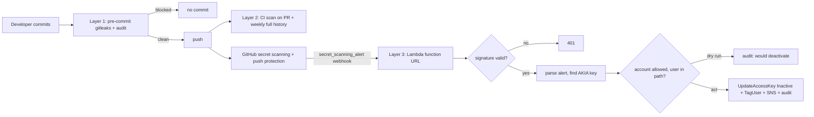

# 04 Secrets guard

Three layers that keep cloud credentials out of git, and shut a leaked AWS key off fast if one gets
out anyway: a pre-commit scan, a CI scan, and an AWS SAM app that deactivates a leaked access key.

## For engineering leaders

**The problem.** A cloud key committed to a repository can be found and used by automated scanners
within minutes, and the bill or the breach follows (see [docs/sources.md](../../docs/sources.md);
the cited reports are flagged VERIFY). One layer is not enough: developers bypass hooks, CI runs
after the push, and nobody is watching at 2 a.m.

**What this proves.**

- Layer 1 stops the commit on the developer's machine, and records that it did.
- Layer 2 scans every pull request and the whole history on a schedule, so a bypassed hook is caught.
- Layer 3 reacts when GitHub raises a secret scanning alert for an AWS key: it verifies the request,
  checks the key belongs to a user it is allowed to touch, deactivates it (never deletes it), tags
  the user, notifies you, and writes an audit record.
- The AWS part is safe by default: dry-run on, one allowlisted account, one IAM user path, no
  delete permission.

**The metrics.** Leaks blocked at pre-commit (count, by rule), and time from alert to key
deactivation (median and p90, from the audit records). "Good" is zero leaks reaching a pushed
commit, and a deactivation time you can state in minutes; this piece does not claim a number for
you.

**Adopt it in a week.**

1. Day 1: install the pre-commit template (layer 1) on one repository.
2. Day 2: add the CI workflow template (layer 2) and turn on GitHub secret scanning and push
   protection (see below).
3. Day 3: in a throwaway sandbox AWS account, deploy the SAM app in dry-run mode and send it a test
   alert. Read the audit records.
4. Day 4: create one demo IAM user under the guarded path, leak its key on purpose, and confirm the
   alert path. Delete the user afterwards.
5. Day 5: decide whether to switch off dry-run, and for which account.

**Limits.**

- GitHub itself notifies AWS when it finds an AWS key in a public repository (AWS is a secret
  scanning partner), and AWS may restrict the key. Layer 3 is a second line, and it covers
  private repositories where you have secret scanning enabled. I could not read the AWS pages
  describing that behavior, so verify it before relying on it.
- Only long-lived IAM user access keys (`AKIA...`) can be deactivated. Temporary keys (`ASIA...`)
  cannot, and are reported only.
- Deactivation can break a running service that uses the key. That is why dry-run is the default,
  and why the guarded IAM user path is explicit.
- The webhook may not carry the secret value. The documented payload fields do not say whether it
  does, so the app can fetch the alert through GitHub's REST API with a token you provide. Without
  a secret value it records "no secret available" and acts on nothing.
- This does not rotate the key, clean git history, or find the key's past use. Deactivating is the
  first step of the response, not the whole of it.
- Secret scanning for private repositories needs a paid GitHub plan with Secret Protection.

## For engineers

### Architecture

### What is in the folder

| Path                           | What it is                                                                     |
| ------------------------------ | ------------------------------------------------------------------------------ |
| `templates/`                   | Copy-in files: pre-commit config, gitleaks rules, CI workflow.                 |
| `src/precommit.ts`             | Wraps gitleaks, records blocked commits (no secret values) in `.git/`.         |
| `src/lambda/`                  | The webhook handler: signature check, alert parsing, decision, AWS adapters.   |
| `template.yaml`                | The SAM template (Function URL, SNS topic, DynamoDB audit table, scoped role). |
| `src/metrics.ts`               | Blocks pre-commit, and time from alert to deactivation.                        |
| `demo/`                        | Offline demo: a real pre-commit block, and the handler run against fakes.      |

### Layer 1: pre-commit

Copy `templates/pre-commit-config.yaml` and `templates/gitleaks.toml` into your repository. The hook
runs `secrets-guard precommit`, which runs gitleaks on the staged changes with `--redact`, and when
it blocks, appends a record (time, rule ids, file count) to `.git/secrets-guard.audit.jsonl`. No
secret value is ever written. The custom rules in `gitleaks.toml` show how to add an internal token
format; the starting config extends gitleaks' defaults.

### Layer 2: CI

Copy `templates/workflows/secrets-scan.yml`. It scans every pull request and runs a full-history
scan weekly. Actions are pinned by SHA and permissions are read-only. The `gitleaks-action` is free
for personal accounts; an organization needs a `GITLEAKS_LICENSE` secret.

**Turn on GitHub's own scanning.** Public repositories get secret scanning free. For private
repositories in an organization you need GitHub Secret Protection. Via the REST API, `PATCH
/repos/{owner}/{repo}` accepts `security_and_analysis.secret_scanning.status` and
`security_and_analysis.secret_scanning_push_protection.status` set to `enabled`. The settings
page path was not confirmed (the docs page I tried returned 404), so use the repository's
Settings, then Code security.

### Layer 3: auto-deactivation (SAM app)

**Nothing is deployed by this repository.** `sam validate --lint` runs offline. Deploying is a
manual step, described in `DEPLOY.md`, with what it creates, what it costs, and how to remove it.

Behavior, in order:

1. Verify `X-Hub-Signature-256` (HMAC SHA-256 over the raw body, constant-time compare). Wrong or
   missing signature: 401, nothing else happens.
2. Accept only `secret_scanning_alert` events with action `created` or `publicly_leaked`. Others:
   202, ignored.
3. Get the secret from the payload, or from the REST API if a GitHub token secret is configured.
   None: audit `no-secret`.
4. Pick out access key ids. `ASIA...` is reported, not acted on. Only `AKIA...` continues.
5. Confirm the running account is in `ALLOWED_ACCOUNT_IDS`. If not, refuse (this guards against the
   stack being deployed to the wrong account).
6. Find the key's owner (`GetAccessKeyLastUsed`) and the user's path (`GetUser`). A user outside
   `USER_PATH` is skipped.
7. Dry-run (default): audit "would deactivate" and notify. Otherwise `UpdateAccessKey` to
   `Inactive`, `TagUser`, notify, audit with `leakToActionSeconds`.

The role has no `DeleteAccessKey`. `UpdateAccessKey`, `GetUser` and `TagUser` are limited to the
guarded user path. `GetAccessKeyLastUsed` is granted on all resources because IAM does not scope
it by resource, as far as I know; I could not read the AWS authorization reference to confirm.

### Config (environment of the function)

| Variable                  | Default (template)      | Meaning                                                     |
| ------------------------- | ----------------------- | ----------------------------------------------------------- |
| `DRY_RUN`                 | `true`                  | When `true`, nothing is changed in IAM.                     |
| `ALLOWED_ACCOUNT_IDS`     | none, required          | Comma-separated. The function refuses to act elsewhere.     |
| `USER_PATH`               | `/secrets-guard-demo/`  | Only users whose path starts with this are touched.         |
| `WEBHOOK_SECRET_ARN`      | created by the stack    | Secrets Manager secret holding the webhook secret.          |
| `GITHUB_TOKEN_SECRET_ARN` | empty                   | Optional token to fetch the alert's secret over REST.       |
| `TOPIC_ARN`, `TABLE_NAME` | created by the stack    | SNS topic for notifications, DynamoDB table for audit.      |

### Acceptance criteria (each has a test)

- AC-1: signature verification accepts a correct signature, rejects a wrong, missing or malformed
  one, and uses the documented test vector.
- AC-2: the handler returns 401 for a bad signature and does nothing else.
- AC-3: events other than `secret_scanning_alert` created or publicly leaked are ignored.
- AC-4: an `AKIA` key owned by an in-scope user in an allowed account is deactivated, the user is
  tagged, SNS is notified and one audit record is written.
- AC-5: dry-run (the default) never calls `UpdateAccessKey` or `TagUser`.
- AC-6: `ASIA` keys, unknown keys, users outside the path and accounts outside the allowlist are
  not touched, and each outcome is audited with a distinct decision.
- AC-7: a missing allowlist refuses to act at all.
- AC-8: the secret value is never written to the audit record, the notification or the logs.
- AC-9: an AWS error is audited and returns 500, so GitHub can retry; deactivation is idempotent.
- AC-10: the pre-commit wrapper records a blocked commit without any secret value, and passes a
  clean commit.
- AC-11: metrics report blocks by rule and leak-to-deactivation median and p90.
- AC-12: the SAM template has no delete permission, no wildcard IAM action, and defaults to dry-run.

### Runtime dependencies

| Package                  | Why                                                           |
| ------------------------ | ------------------------------------------------------------- |
| `zod`                    | Validate the webhook payload and config.                      |
| `@adl/shared`            | Audit record helpers, hashing (workspace).                    |
| AWS SDK v3 clients (dev) | `iam`, `sts`, `sns`, `dynamodb`, `secrets-manager`. Types and command classes; the Lambda runtime provides the SDK, so they are not bundled. |

### Security notes

- The webhook endpoint is a public Lambda Function URL with no AWS auth. The HMAC signature is the
  only gate, so the webhook secret must be long and random (the stack generates one).
- Raw bodies are verified before they are parsed. The secret is never logged, notified or stored;
  only a SHA-256 of the key id and its last four characters are kept.
- All tests use fakes. No test calls AWS or GitHub.
- GitHub details were checked against the current docs on 2026-11-24. The AWS pages (IAM resource
  scoping, Lambda runtimes, Function URL payload, SAM esbuild) could not be read in this session
  because the repository's own agent guardrails block `docs.aws.amazon.com`. Items that depend on
  them are marked "verify" below.

### Verify before you deploy

- The Lambda runtime identifier in `template.yaml` (`nodejs22.x`) is current and includes SDK v3.
- The Function URL event shape (version 2.0: lowercase header names, `isBase64Encoded`).
- `iam:GetAccessKeyLastUsed` has no resource-level scoping.
- The SAM `esbuild` build metadata matches the installed SAM CLI.

### Status

Draft for review. Not deployed, and never run against AWS or a real GitHub webhook. The demo runs
the real handler and the real gitleaks binary against fakes and a temporary repository.
