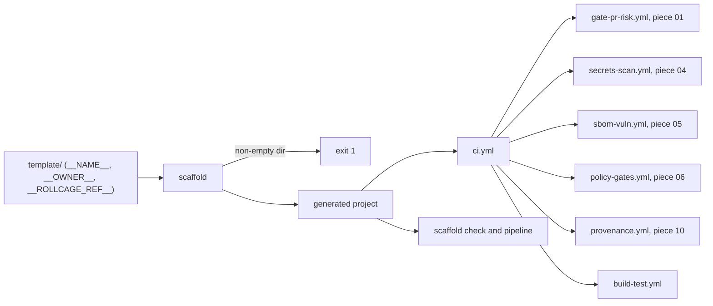

# 12 Golden path template

A template for a new TypeScript service, and a `scaffold` CLI that generates a project from it. The
generated repo starts with the controls from this library already wired in: PR risk gate, secrets
scanning, SBOM and vulnerability triage, policy gates, provenance verification, pre-commit,
CODEOWNERS, a PR template, Dependabot, a security policy and a branch-protection setup guide.

## For engineering leaders

**The problem.** Every new service gets its own copy of CI, its own review rules and its own idea
of what "secure enough" means. Controls that exist only in the library do not protect a repo that
never adopted them, and each team spends its first weeks rebuilding the same plumbing.

**What this proves.**

- A new repo can start with the controls already on, so the safe path is also the fast path.
- The generated pipeline calls the library's pieces through reusable workflows, so upgrading a
  control means changing one ref, not editing every repo.
- Every third-party action in the generated repo is pinned by commit SHA.
- The scaffold refuses to touch a directory that already has files in it.
- The generated sample service installs, lints, tests and builds on a laptop, and a CI test in this
  repo proves that on every change.

**The metrics.**

| Metric                                  | How this piece measures it                                                                                                                                  | What "good" looks like                                                    |
| --------------------------------------- | ----------------------------------------------------------------------------------------------------------------------------------------------------------- | ------------------------------------------------------------------------- |
| Time from new repo to first prod deploy | The repo's creation timestamp to its first successful production deployment timestamp. You read both from GitHub (commands below) and record them per repo. | Your own trend: new repos get faster than the ones you onboarded by hand. |
| Share of repos on the golden path       | `scaffold check <repo>...` prints the percentage of the repos you list that carry the golden path files and pass the pinning check.                         | A rising percentage across the repos you list.                            |

This tool does not compute the first metric. It cannot know what counts as "production" in your
organization. The commands to read the two timestamps are in "Measuring time to first deploy".

**Adopt it in a week.**

1. Day 1: decide which ref of this library the pieces are wired to (see "Pieces wired by path") and
   read the generated `docs/branch-protection.md`.
2. Day 2: scaffold one real service, push it, and apply the branch-protection settings from the
   guide.
3. Day 3: run the generated pipeline on a pull request and change what your org needs in your copy
   of the template.
4. Day 4: scaffold the next two services from the same template.
5. Day 5: run `scaffold check` over your repos and record the percentage and the time to first
   deploy as the baseline.

**Limits.**

- It starts a repo on the path. It does not keep repos there. A team can delete a workflow after
  scaffolding. `scaffold check` is how you notice.
- The sample service is a minimal HTTP greeting handler. It is a place to start, not an
  architecture.
- Pieces 05, 06 and 10 are wired by path on an agreed contract (inputs listed below). If the ref
  you choose does not contain them, the generated workflows for them fail until it does.
- Branch protection is a manual setup step. This piece writes the guide and the `gh` command. It
  does not run it.
- The default ref is a tag, and a tag can move. See "Pinning" to resolve it to a SHA.

## For engineers

### Architecture



### Install and run

```bash
pnpm install
pnpm --filter @adl/golden-path-template scaffold ~/code/payments-api \
  --name payments-api --owner my-org --ref v0.3.0
```

### Add to an existing repository

`scaffold init [dir]` adds the guardrails to a repository you already have, instead of generating a
new one. From the repository root, `curl ... install.sh | bash` (see the root README) fetches
rollcage, runs `init` and cleans up; from a clone of this repo,
`pnpm --filter @adl/golden-path-template scaffold init ~/code/my-repo --ref <sha>`.

It writes `.github/workflows/rollcage.yml` (the caller), one `rollcage-*.yml` per piece, and
`risk-gate.yml`. Pieces: `risk-gate`, `secrets`, `sbom`, `policy` (default) and `provenance`
(opt-in, because it verifies a build artifact). `--extras --owner <login>` adds CODEOWNERS,
Dependabot, SECURITY.md and a PR template. Rules:

- It never overwrites. A file that exists is skipped and listed.
- `--dry-run` lists what would be written and writes nothing.
- Nothing is rendered to disk until the pin check passes: rollcage pieces must use `--ref`, and
  every other action must be pinned to a commit SHA. A tag in `--ref` produces a warning, so the
  installer pins to the SHA it fetched.
- It prints the check names to require in branch protection after the first pull request. It does
  not change any setting.
- The risk-gate workflow here omits the pnpm setup step the template project uses, so a repository
  with no pnpm version still works.

Verified by hand on 2026-11-25 against a fresh git repository, from `install.sh` with a local
source. The workflows have not yet run on GitHub from a repository set up this way.

Commands:

| Command                                             | What it does                                                                         |
| --------------------------------------------------- | ------------------------------------------------------------------------------------ |
| `scaffold <dir> --name <n> --owner <o> [--ref <r>]` | Generate a project. Exit 1 if `<dir>` has any entry in it or an input is invalid.    |
| `check <dir>...`                                    | Report each directory as on or off the golden path, and the percentage on it.        |
| `pipeline <dir> [--link-modules <path>]`            | Run the generated project's pipeline steps locally. GitHub-only jobs are listed as skipped. |

`--link-modules <path>` symlinks an existing `node_modules` into the project instead of running
`pnpm install`, so the run needs no network. The CI test uses the monorepo's own `node_modules`.
Without it, `pipeline` runs a real `pnpm install`.

Inputs are validated. `--name` is lowercase letters, digits and hyphens, starting with a letter, up
to 64 characters. `--owner` is a GitHub user or organization login. `--ref` is a tag, branch or
40-character SHA made of letters, digits, `.`, `_`, `-` and `/`.

### What is generated

```text
.github/
  CODEOWNERS
  dependabot.yml
  pull_request_template.md
  workflows/
    ci.yml                 the caller: runs the reusable workflows below
    build-test.yml         install, lint, typecheck, test, build
    gate-pr-risk.yml       piece 01
    secrets-scan.yml       piece 04 (gitleaks)
    sbom-vuln.yml          piece 05
    policy-gates.yml       piece 06
    provenance.yml         piece 10
.pre-commit-config.yaml
.golden-path.json          template marker read by `scaffold check`
SECURITY.md
docs/branch-protection.md
risk-gate.yml
src/ tests/                the sample service
package.json tsconfig.json eslint.config.js vitest.config.ts README.md .gitignore
```

The reusable workflows live in the generated repo and declare `on: workflow_call`. `ci.yml` calls
them with `uses: ./.github/workflows/<name>.yml`. To share them across many repos, move them to
one repo and change the `uses:` lines to `owner/repo/.github/workflows/<name>.yml@<sha>`.

### Pieces wired by path

Pieces 05, 06 and 10 were built in parallel with this one. The generated workflows reference them
by path on an agreed contract and are not tested against them here.

| Piece                 | `uses:`                                                   | Inputs                                                   |
| --------------------- | --------------------------------------------------------- | -------------------------------------------------------- |
| 01 PR risk gate       | `frankTurtle/rollcage/pieces/01-pr-risk-gate@<ref>`       | `config` (default `risk-gate.yml`), `mode`               |
| 05 SBOM vuln triage   | `frankTurtle/rollcage/pieces/05-sbom-vuln-triage@<ref>`   | `path` (default `.`), `fail-on` (default `critical`)     |
| 06 Policy gates       | `frankTurtle/rollcage/pieces/06-policy-gates@<ref>`       | `path` (default `.`), `policy` (optional)                |
| 10 Provenance signing | `frankTurtle/rollcage/pieces/10-provenance-signing@<ref>` | `artifact` (path), `mode` (`verify` default or `attest`) |

Piece 04 is not an action. The generated `secrets-scan.yml` is the reusable form of
`pieces/04-secrets-guard/templates/workflows/secrets-scan.yml`, and the generated
`.pre-commit-config.yaml` follows `pieces/04-secrets-guard/templates/pre-commit-config.yaml`
(with the gitleaks default rules, since the generated repo has no `secrets-guard` build).

All five use one placeholder, `__ROLLCAGE_REF__`, which the scaffold replaces with `--ref`. The
default is `v0.3.0`. That ref must point to a release that contains pieces 05, 06 and 10. If the
release you pick does not, pass a commit that does.

### Pinning

Third-party actions in the template (`actions/checkout`, `actions/setup-node`,
`pnpm/action-setup`, `gitleaks/gitleaks-action`) are pinned by commit SHA with a version comment.
The scaffold checks every `uses:` line in the generated workflows:

- `./...` local references pass.
- `<owner>/<repo>[/path]@<40 hex characters>` passes.
- `frankTurtle/rollcage/...@<ref>` passes, with a warning when `<ref>` is not a SHA, because a tag
  can move.
- Anything else fails the scaffold and `check`.

To turn the tag into a SHA before you rely on it:

```bash
git ls-remote https://github.com/frankTurtle/rollcage refs/tags/v0.3.0
pnpm --filter @adl/golden-path-template scaffold ~/code/payments-api \
  --name payments-api --owner my-org --ref <sha>
```

Dependabot (`github-actions` ecosystem) keeps the SHAs current.

### Measuring time to first deploy

Verify before you deploy. Nothing in this piece calls GitHub. A maintainer can read the two
timestamps for one repo with:

```bash
gh api repos/<owner>/<repo> --jq .created_at
gh api "repos/<owner>/<repo>/deployments?environment=production&per_page=1&direction=asc" --jq '.[0].created_at'
```

Check `gh api --help` for your version. Deployment records exist only if your deploy workflow
creates them.

### Acceptance criteria (each has a test)

1. `scaffold` writes every template file into a new directory with name, owner and ref substituted,
   and no `__NAME__`, `__OWNER__` or `__ROLLCAGE_REF__` token is left.
2. `scaffold` into a directory that has any entry (including a dotfile) exits 1 and writes nothing.
   An existing empty directory is accepted.
3. Invalid `--name`, `--owner` or `--ref` is rejected with a message, and nothing is written.
4. Every `uses:` line in the generated workflows is local, SHA-pinned, or the rollcage ref. An
   unpinned third-party action fails the check.
5. Every generated reusable workflow has `on: workflow_call` and a top-level `permissions:` block.
6. `ci.yml` calls pieces 01, 04, 05, 06 and 10 by the contract in the table above, using the one ref.
7. The generated project contains pre-commit config, CODEOWNERS (owned by `--owner`), a PR template,
   Dependabot config, SECURITY.md and the branch-protection guide.
8. `check` reports a scaffolded directory as on the path, a bare directory as off it, and the
   percentage across all listed directories.
9. `pipeline` on a freshly scaffolded project runs install, lint, typecheck, test and build, and all
   pass. The GitHub-only jobs are listed as skipped.
10. The CLI returns exit 2 on an unknown command or a missing argument, and prints usage.

### Tests

```bash
pnpm --filter @adl/golden-path-template coverage
```

Unit tests cover validation, rendering, the empty-directory rule, the pin check, `check` and the
CLI. `tests/pipeline.test.ts` scaffolds into a temp directory, links the monorepo's `node_modules`,
and runs the real lint, typecheck, test and build of the generated sample service. No test uses
the network. Coverage floor is 90% lines.

### Runtime dependencies

- `tsx` runs the CLI from source, like the other pieces.

The scaffold uses only Node built-ins. The generated project's dev dependencies are listed in its
`package.json` and use the same version ranges as this monorepo.

### Security notes

- The scaffold writes only under the target directory. Template paths are fixed, and substituted
  values are validated against strict patterns before any file is written.
- It never overwrites. The non-empty check runs before the first write.
- Generated workflows set `permissions: contents: read` at the top and grant more only to the job
  that needs it. Checkout uses `persist-credentials: false`.
- The branch-protection guide contains a `gh api` command. The scaffold does not run it.
- The generated `SECURITY.md` points to GitHub private vulnerability reporting. You must enable it
  on the new repo.

### Status

Backlog piece 12. Pieces 05, 06 and 10 are referenced by path and not tested here.
